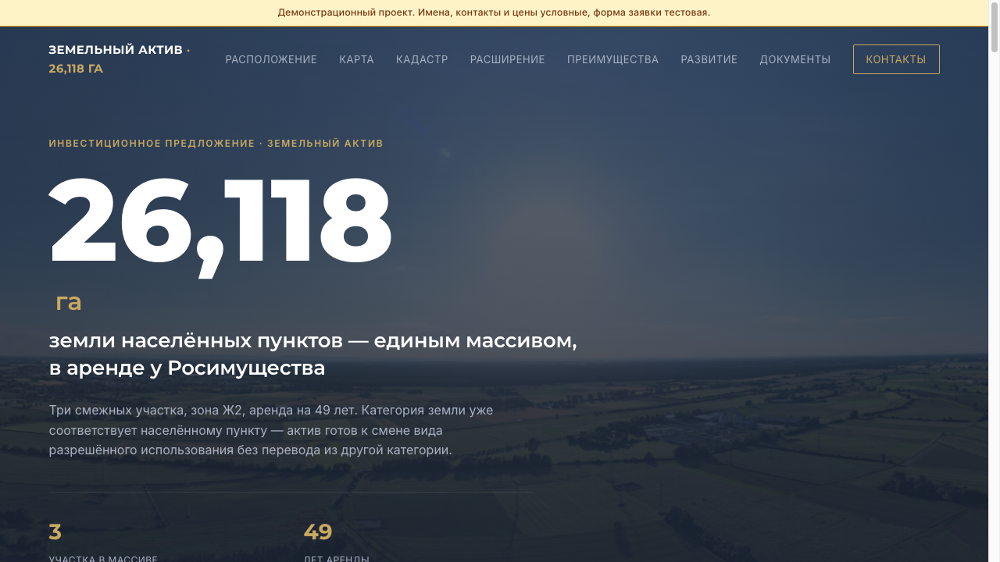

# Land Asset 5 — земельный актив

Инвестиционный лендинг: три смежных участка 26,118 га, аренда 49 лет.

> **Демонстрационный проект.** Имена, контакты, адреса и цены на сайте условные и показаны как пример; форма заявки тестовая.

**Онлайн:** https://landasset5.gonka.blog



## Что внутри

- Цифры актива, карта, кадастр, перспективы развития, документы по запросу
- Форма запроса пакета документов: телефон, почта, сообщение
- Страница подтверждения `success-page.html`

## Стек

чистые HTML / CSS / JavaScript, Google Apps Script, Google Таблицы. Сборка не нужна: это статические файлы.

## Запуск

открыть `index.html` в браузере

## Форма заявок

Форма отправляет данные в веб-приложение Google Apps Script. Скрипт записывает строку в Google Таблицу и присылает письмо. Код лежит в папке `backend/`.

1. Создайте проект в Google Apps Script и вставьте код из `backend/`.
2. Укажите свою почту для уведомлений и разверните как веб-приложение (доступ: «Все»).
3. Вставьте полученный адрес `/exec` в настройки сайта (в `index.html`, `script.js` или `config.js`, смотря где он указан).

В демонстрационной версии телефоны, почты и имена условные.

## Структура

```
landasset5/
├── backend/
├── index.html
├── script.js
├── styles.css
├── success-page.html
└── docs/            скриншоты
```

## Автор

Олег, [GitHub: textsmen-design](https://github.com/textsmen-design).
